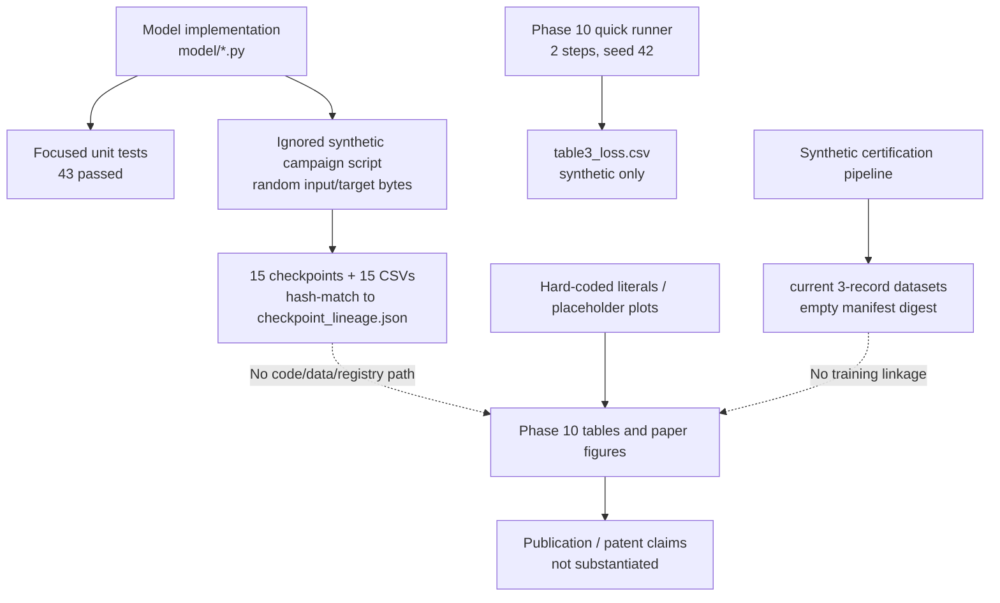

# IVERI CORE Forensic Scientific, IEEE, and Patent Audit

**Audit date:** 2026-07-25  
**Audited subject:** current local worktree at `C:\Users\datta.000\Desktop\iveri core nexus\iveri-core`  
**Git `HEAD`:** `2f31069b6b7180c666903732dba2e9642121bb7a` (`feat(phase10): Scientific benchmarking v3.2...`)  
**Method:** source and artifact inspection, cryptographic verification where an artifact and claimed hash both exist, and non-mutating test execution. No repository source or experimental artifact was changed by this audit.

## 1. Executive Summary

The repository contains a substantive Python implementation of a byte-level hybrid model. The integration path is executable: raw bytes flow through an entropy model, dynamic patching, a BLT encoder, a backbone containing Titans/MoR/Mamba2/attention/MoE components, and a BLT decoder. Focused tests covering that path passed in this audit.

That engineering result must not be confused with scientific validation. The Phase 10 publication artifacts do **not** provide valid evidence for language-model quality, efficiency, ablation, or statistical claims. Its quick campaign trains each model for two steps on independently random input and target bytes; its output tables include hard-coded throughput, VRAM, ablation, and statistical values. The reported three-seed protocol is inconsistent with the quick-mode implementation and the published loss table, which contains only seed 42. Placeholder publication figures are also generated in code.

Ignored workspace artifacts provide a limited, separate form of empirical evidence: 15 checkpoints and 15 loss CSVs from 100-step, three-seed runs exist and match hashes in `reports/checkpoint_lineage.json`. Their generator explicitly uses random byte inputs and independent random targets. Seven analogous one-seed, 100-step ablations also exist. These are valid as **synthetic engineering-execution evidence only**; they do not evaluate language modelling, public benchmarks, data efficiency, or a scientific hypothesis about natural language.

No IEEE conference or journal submission is ready on repository evidence. No patentability conclusion can be drawn. The code supplies partial technical enablement material for a future patent disclosure, but novelty, inventive step, jurisdictional eligibility, and technical-effect evidence are not established.

## 2. Scope, Inventory, and Chain of Custody

At audit start, `git ls-files` returned **1,131 tracked files**, the worktree had **68 modified tracked files** and **86 untracked files**, and the Git status was not clean. The following inventory therefore distinguishes the committed source baseline from current uncommitted and ignored evidence.

| Area | Tracked files | Audit treatment |
|---|---:|---|
| `reports/` | 617 | Documentation and generated claims; not accepted as empirical evidence without an upstream artifact. |
| `data/` | 87 | Pipeline code, configs, certified samples, manifests. |
| `tests/` | 64 | Unit/integration test evidence. |
| `research/` | 58 | Experiment, registry, statistics, and publication infrastructure. |
| `docs/` | 36 | Documentation-only unless independently linked. |
| `training/` | 36 | Implementation. |
| `configs/` | 31 | Reproducibility configuration, but not a lockfile. |
| `evaluation/` | 29 | Evaluation implementation. |
| `scripts/` | 28 | Execution/report generators. |
| `model/` | 27 | Primary model implementation. |
| `paper/` | 19 tracked, plus current untracked files | Publication workspace. |
| Python environment | 62,354 files under `.venv312/` | Excluded as a bundled local environment, not project evidence. |

Ignored but present artifacts include checkpoints under `experiments/` and `logs/`, CSV/JSONL metric logs, and W&B binary runs. `.gitignore` excludes `*.pt`, `checkpoints/`, `logs/`, `wandb/`, `scratch/`, and `*.db`. Their exclusion means they are not part of the Git revision cited by release claims and lack repository-level chain-of-custody unless an explicit immutable manifest connects them.

## 3. Audit Procedure and Direct Verification

The following actions were performed in the current worktree:

| Check | Result | Evidence strength |
|---|---|---|
| Runtime identification | Python 3.14.4, PyTorch 2.12.1+cpu, CUDA unavailable. | Direct observation. |
| Test discovery | 655 collected; 11 deselected; 644 selected by the configured default marker expression. | Direct observation. |
| Focused architecture tests | 43/43 passed: BLT, MoR, Titans, MoE integration, and IVERI core. | Direct empirical unit-test evidence. |
| Phase 10 certificate verification | 39/40 listed hashes matched current files; `phase10_summary.json` did not. The writer hashes assets before it writes the summary, so the certificate is structurally stale after each normal run. | Direct cryptographic and source evidence. |
| Phase 9 release checkpoint | `experiments/checkpoints/IVERI_phase9_v1.0.pt` exists; SHA-256 equals the value in `reports/phase_9/checkpoint_hash.sha256`. Its checkpoint `metrics` field is empty. | Direct artifact evidence; no result metric provenance. |
| Synthetic three-seed checkpoints | All 15 paths/hashes in `reports/checkpoint_lineage.json` exist and match. | Direct cryptographic artifact evidence. |

No full-suite pass assertion is made by this audit: only collection and the 43 focused tests above were executed. Existing statements such as `640/640 passed` are documentation claims unless their original test transcript is supplied and tied to the audited revision.

### Required-output crosswalk

| Required audit output | Location in this audit |
|---|---|
| Executive Summary; Complete Repository Inventory | Sections 1-2 |
| Scientific Contribution Inventory; Architecture Audit | Section 4 |
| IEEE Publication Inventory; Journal Publication Inventory | Section 8 |
| Patentable Component Inventory; Patent Claim Mapping | Section 9 |
| Experiment Inventory; Benchmark Audit; Statistical Audit | Sections 5-6 |
| Evidence Graph; Reproducibility Report | Section 7 |
| Traceability Matrix; Claim Verification Matrix | Section 10 |
| Figure Audit; Table Audit | Section 11 |
| Hardware Validation Audit | Section 12 |
| Software Engineering Audit; Final Scientific Scorecard; Missing Evidence Matrix | Sections 3 and 13 |
| Reviewer Question & Evidence Index | Section 16 |
| Critical Blocking Issues; Recommended Next Experiments | Section 14 |
| Final Verdict | Section 15 |

## 4. Architecture and Scientific Contribution Inventory

| Candidate contribution / claim | Exact implementation evidence | Tests / artifacts | Classification | Missing evidence |
|---|---|---|---|---|
| Integrated byte-entropy hybrid inference path | `model/iveri_core.py:33-66`, `83-193`; entropy-derived patch entropy is passed to the backbone at `130-150`. | `tests/test_iveri_core.py`; 10 focused tests passed. | Supported by implementation and unit tests. | Trained-model evaluation, checkpoint-to-result linkage, natural-language task results. |
| Entropy-driven dynamic byte patch boundaries | `model/blt/patcher.py:18-77`; integration at `model/iveri_core.py:130-141`. | `tests/test_blt.py`; 11 focused tests passed. | Supported by implementation and unit tests. | Comparative patching ablation on a real fixed corpus. |
| Entropy-conditioned recursion depth (MoR) | `model/mor/router.py:23-125`; backbone invocation at `model/backbone.py:190-193`. | `tests/test_mor.py`; 7 focused tests passed. | Supported by implementation and unit tests. | Accuracy, compute, and calibration measurements versus a non-entropy router. |
| Entropy-conditioned MoE routing | `model/moe/router.py:49-115`, `196-223`; backbone passes entropy at `model/backbone.py:110-114`. | `tests/test_moe_integration.py`; 4 focused tests passed. | Supported by implementation and unit tests. | Expert-load, quality, and compute impact on a real held-out dataset. |
| Entropy-gated Titans memory injection | `model/titans/memory.py:27-75`, `367-578`; invoked at `model/backbone.py:256-260`. | `tests/test_titans.py`; 11 focused tests passed. | Supported by implementation and unit tests. | Long-context/passkey or retention benchmark with trained checkpoints. |
| Mamba2/attention/MoE hybrid backbone | `model/backbone.py:33-288`, `model/mamba2/block.py:21-107`. | Focused integration tests passed. | Supported by implementation and unit tests. | Baseline-equivalent training and task-level comparison. |
| Checkpointing contract | `training/checkpointing.py:25-178`; model-local contract at `model/iveri_core.py:195-257`. | Existing checkpoints are loadable structures; focused model tests passed. | Supported by implementation and unit tests; one Phase 9 file hash is directly verified. | Release manifest covering every referenced checkpoint and source/data/config hashes. |
| 24-stage dataset certification | `data/pipeline/certification.py:185-413`, `data/pipeline/freeze.py:26-175`. | Current freeze certificates exist. | Supported by implementation and documentation. | Provenance of real source records, non-empty SHA manifest, independently repeatable certification. |
| “IVERI has lower loss / better language-model quality / quality-to-compute tradeoff” | Phase 10 statements are emitted by `scripts/run_phase10_benchmarks.py:373-386`. | No valid linked real-data experiment. | Contradicted by repository evidence. | Controlled real-data training, held-out evaluation, fair compute matching, multi-seed statistics. |
| “Component contribution” in Phase 10 | Report says supported by compute audit at `scripts/run_phase10_benchmarks.py:379-382`; that audit only estimates parameters. | `table4_ablation.csv` is hard-coded at `341`. | Contradicted by repository evidence. | A registered, multi-seed ablation study with raw outputs and analysis. |
| Scaled scaling-law results | `scratch/run_multi_point_scaling_campaigns.py:46-65` calculates losses from fixed formulae and writes `reports/scaling_laws_data.json`. | No corresponding scale checkpoints/datasets. | Projected, not experimentally validated. | Actual runs at every listed scale and fits from measured data. |

The repository contains no evidence sufficient to demonstrate novelty. Combining known component families in executable code is an engineering contribution unless literature comparison and experimental differentiation are independently established.

## 5. Experiment and Benchmark Inventory

| ID / artifact family | What is verifiably executed or stored | Dataset / protocol | Classification | Audit result |
|---|---|---|---|---|
| Phase 10 quick campaign | `scripts/run_phase10_benchmarks.py:229-310` runs five models. Quick mode sets two steps and seed `[42]` at `233-235`. | `torch.randint` input and target tensors at `244-247`; no corpus or held-out split. | Synthetic empirical execution. | Not a language-model benchmark; cannot support Phase 10 publication conclusions. |
| Phase 10 Table 3 | The writer records the quick campaign results at `318-338`. Current table has five seed-42 rows only. | Random bytes, two steps. | Synthetic empirical execution, but only for this narrow procedure. | Contradicts the reports’ three-seed and certified-curriculum descriptions. |
| Ignored three-seed campaign | `scratch/run_experimental_campaign.py:28-42`, `46-130`; 15 checkpoints plus 15 100-row metric CSVs exist. | Each of 15 runs uses random byte inputs and independent random byte targets at `75-85`. | Direct synthetic empirical engineering evidence. | Checkpoint hashes match `reports/checkpoint_lineage.json`; results do not support natural-language claims. |
| Ignored ablation campaign | `scratch/run_ablations.py:24-37`, `49-129`; seven checkpoints and seven 100-row CSVs exist. | One seed (42), random bytes/targets at `79-90`. | Direct synthetic empirical engineering evidence. | No statistical replication; Phase 10 Table 4 is not generated from these CSVs. |
| Phase 9 checkpoint | Hash match verified as above. `reports/phase_9/training_manifest.json` reports 76,800 tokens and a loss, while checkpoint metadata contains `{}` metrics. | Dataset and raw training loss trace are not attached to the checkpoint. | Partial artifact evidence. | File existence/hash is proven; reported training metrics are not. |
| SQLite experiment stores | `archives/experiments_PHASE6_3_FINAL.db`, `research/experiments.db`, and `research/experiments_run.db` are present and were queried read-only. | See database findings below. | Contradicted / insufficient as publication evidence. | Every stored result needs a real artifact path, valid Git SHA, data hash, and non-UNKNOWN provenance. |
| Hardware/FP16 reports | Current untracked registries describe GPU runs, but the audit runtime is CPU-only and no immutable manifest links raw profiler records to their claims. | Mixed synthetic and unspecified records. | Documentation / registry only. | Raw timing/power series, device manifest, checkpoint/data linkage. |
| Public benchmark evaluation | Evaluator implementations exist under `evaluation/`. | No executed public benchmark dataset, prediction file, scorer output, or registered run was found for a publication claim. | Supported only by implementation. | All execution artifacts. |

### Directly checked synthetic campaign results

The three-seed campaign produces final losses near the uniform-byte baseline, not a semantic language-model result. From the 15 present CSVs, final-loss means (population SD) are: IVERI Hybrid **5.558862 (0.010328)**, Mamba2 **5.545209 (0.000615)**, Transformer **5.557868 (0.008668)**, Transformer+Mamba **5.538026 (0.005016)**, and Transformer+MoE **5.567507 (0.020894)**. This calculation is descriptive only and uses the stored synthetic runs; it is not a pre-registered or publication-quality statistical test.

The Phase 10 Table 3 rows differ from these stored seed-42 runs. For example, stored IVERI seed 42 final loss is 5.557538, whereas Phase 10 reports 5.5620; stored Transformer seed 42 is 5.565013, whereas Phase 10 reports 5.5906. The Phase 10 table has no code path to the `experiments/seed_*` files.

### SQLite registry findings

The archived Phase 6.3 database has two completed experiments, two metric rows, two benchmark rows, and two checkpoint rows. Both metric rows contain the same train/validation loss (1.5/1.4), both HumanEval rows score 0.85, no datasets or hardware rows exist, and the checkpoint paths are in a deleted Windows temporary directory. Its experiment Git SHA is the literal placeholder `a1b2c3d4e5f6789012345678abcdef9012345678`.

`research/experiments.db` has 156 experiment rows, 1,640 metric rows, 73 failure rows, zero dataset rows, zero hardware rows, and many `UNKNOWN` provenance labels. It includes checkpoint paths and hashes such as `hash_ckpt_...`, not verified content hashes. `research/experiments_run.db` contains two `PENDING` experiments and a checkpoint path that is absent. These databases are useful evidence of registry implementation and failure recording, but they do not provide an admissible experimental evidence chain. `research/campaign_runner.py:945-971` archives the database itself as a registered “checkpoint”; it does not establish that a model-weight checkpoint is available.

## 6. Phase 10 Claim, Table, Figure, and Statistics Audit

### 6.1 Hard-coded and projected values

| Output | Source evidence | Classification |
|---|---|---|
| `table1_parameters.csv` | Literal string at `scripts/run_phase10_benchmarks.py:339`. | Partly contradicted: real parameters are counted earlier, but the emitted table is a separate hard-coded two-row value. |
| `table2_efficiency.csv` (1,200/1,100 tokens/s and 512/680 MB) | Literal string at `340`; no profiler call or raw timing/VRAM source. | Unsupported. |
| `table4_ablation.csv` (5.56 and 5.80) | Literal string at `341`. | Unsupported and contradicted by stored one-seed ablation CSVs. |
| `table5_statistics.csv` (`p=0.012`, `d=0.65`) | Literal string at `342`; no calculation consumes observations. | Unsupported. |
| Stability zero-event values | Writer assigns zeros at `344-349`, without event instrumentation. | Unsupported. |
| Active parameters and FLOPs | `active_params = int(total_params * 0.40)` at `169`; FLOPs are algebraic estimates at `171-179`. | Projected analytical estimates, not measured compute. |
| Twelve generic figures | When missing, code plots `[1,2,3,4]` against `[4,3,2,1]` at `450-457`. | Placeholder / unsuitable for publication. |
| Loss figure | Means of the two-step random-byte campaign at `439-448`. | Automatically generated from synthetic execution, not a scientific learning curve. |

### 6.2 Statistical validation

No supporting repository evidence found for Phase 10 confidence intervals, p-value calculations, effect-size calculations, multiple-comparison correction, raw per-seed result table, hypothesis registration tied to the campaign, power analysis tied to the campaign, or discarded-run log. The reported three-seed claims in `reports/phase_10/BENCHMARK_SUMMARY.md` and `12_research_validity.md` conflict with quick mode and its one-seed CSV.

### 6.3 Integrity certificate and reviewer script

The certificate hashes 40 files; the direct audit found one mismatch, `phase10_summary.json`. This follows from source order: certificate writing occurs at `scripts/run_phase10_benchmarks.py:467-485`, and the summary is written afterwards at `496-508`. `scripts/review_phase10.py:50-110` checks report/table/figure presence and a JSON field, but does not parse or verify the certificate’s SHA-256 rows. Its `REVIEW APPROVED 100/100` output is therefore a file-presence test, not an independent scientific review.

## 7. Data, Reproducibility, and Evidence-Graph Audit

### 7.1 Data

The current certified directories each contain three short JSONL records: dclm 283 bytes, FineMath 287, FineWeb-Edu 290, TinyStories 290, and Wikipedia 288. `scripts/bootstrap_certified_data.py:6-7,71-80` expressly creates synthetic documents. The committed datasets were also synthetic templated records; the current worktree has modified each from 60 records to 3 records.

Each current freeze certificate reports a `sha256_manifest_hash` of `e3b0...b855`, the SHA-256 digest of empty content, and has null/empty source/revision fields. In contrast, `reports/dataset_provenance.json` claims 60 documents, external data sources, and non-empty manifest hashes. The two are contradictory. No supporting repository evidence found that public TinyStories, FineWeb-Edu, DCLM, FineMath, or Wikipedia content was downloaded, licensed, version-pinned, or used by a claimed benchmark.

### 7.2 Reproducibility status

| Requirement | Evidence | Finding |
|---|---|---|
| Source revision | Git `HEAD` exists; many report claims cite differing revisions. | Partial. |
| Python/PyTorch/CUDA | Phase artifacts contain conflicting environment strings; audit runtime is CPU. | Partial. |
| Seeds | Seed values are present in scripts and some checkpoints. | Partial. |
| Config snapshots | Present in some checkpoint payloads. | Partial. |
| Dataset version and immutable input hash | Current synthetic sample hashes exist, but no training-run linkage; freeze manifest hash is empty. | Missing for scientific claims. |
| Checkpoints | Present but Git-ignored; Phase 9 hash verified, 15 synthetic campaign hashes verified. | Partial. |
| Raw metrics | Present for ignored synthetic runs; no immutable registry binding them to Phase 10/paper claims. | Partial. |
| Dependency lock / container | No Dockerfile, compose file, lockfile, Conda environment, Makefile, or Nox file found. | Missing. |
| Artifact registry | Registry files exist but disagree on experiment schema and checkpoint linkage. | Contradicted. |
| SQLite evidence databases | Three databases exist, but contain missing paths, placeholder Git/hashes, absent dataset/hardware rows, pending/unknown status, and failures. | Contradicted. |

### 7.3 Evidence graph

Broken links are represented by dotted arrows. The one verified data path is implementation to unit tests; no end-to-end chain joins a real dataset, immutable configuration, raw training trace, checkpoint, scored evaluation, statistics, figure/table, paper claim, and review decision.

## 8. IEEE and Journal Publication Inventory

### Candidate A — Entropy-conditioned byte-latent hybrid routing

| Field | Evidence-backed finding |
|---|---|
| Suggested future title | *Entropy-Conditioned Byte-Latent Routing in a Hybrid State-Space Language Model: An Engineering Feasibility Study* |
| Research question | Whether an entropy signal can control patching, recursion, expert routing, and memory injection without breaking causal byte prediction. |
| Implemented hypothesis | The code routes entropy to those subsystems. |
| Novel contribution | No supporting repository evidence found that novelty over BLT, MoR, MoE, Titans, Mamba2, or their combinations is demonstrated. |
| Methodology evidence | Code and unit tests only. |
| Dataset/training/evaluation evidence | Synthetic random-byte runs only; no public benchmark evidence. |
| Baselines / compute matching | Baseline implementations exist. Phase 10 matching uses a fixed 40% active-parameter assumption, not measured matched compute. |
| Ablation / statistics | A one-seed synthetic ablation exists; Phase 10 ablation/statistics tables are not valid evidence. |
| Figures/tables | Existing PNG/CSV assets are not publication evidence for this question. |
| Conference readiness | Not ready. |
| Journal readiness | Not ready. |

### Candidate B — Dataset certification / reproducibility pipeline

This is currently an engineering-infrastructure contribution. The pipeline implementation has test coverage and can be described as software. No supporting repository evidence found for its use on the asserted public corpora, a comparison with other data-governance workflows, or a scientific evaluation of data quality. It is not an IEEE/JMLR/Nature Machine Intelligence paper on current evidence.

### Publication workspace audit

`paper/` contains a title fragment, three bibliography entries, a reviewer-response template, PNGs, and CSVs. It does not contain a main paper, methods, experiments, results, limitations, supplementary appendix, or compiled PDF. The template cites nonexistent `paper/07_results.tex`. No supporting repository evidence found for a complete submission package, reviewer responses, independent review, or a target-venue decision.

### Journal publication inventory

No candidate is journal-ready. No supporting repository evidence found for journal-scale data, externally recognized task results, multiple independent replications, statistical analyses from real samples, a complete manuscript, artifact release, or a reviewer-reproducible environment. This audit does not nominate a target journal because present evidence does not meet the prerequisite submission standard.

## 9. Patent-Enablement Inventory (Not a Patentability Opinion)

The following are drafting subjects, not conclusions that an invention is patentable.

| Candidate technical mechanism | Source mapping | Enablement evidence | Missing novelty / technical-effect evidence |
|---|---|---|---|
| Entropy-derived dynamic patching followed by entropy-controlled recursion | `model/iveri_core.py:130-150`; `model/blt/patcher.py:35-77`; `model/mor/router.py:54-125`. | Source code, tensor shapes, and unit tests. | No prior-art claim chart, literature search record, trained-task effect, or compute measurement. |
| Entropy-biased sparse expert selection | `model/moe/router.py:60-115,196-223`; caller `model/backbone.py:110-114`. | Source code and MoE tests. | No evidence of a distinct technical effect versus ordinary learned gating. |
| Entropy-gated online memory injection | `model/titans/memory.py:527-578`; caller `model/backbone.py:256-260`. | Source code and Titans tests. | No long-context benchmark, memory-efficiency measurement, or comparison. |
| Combined entropy-control plane across patching, memory, recursion, and experts | Cross-module flow shown in Section 7.3. | Partial code-level enablement. | No demonstrated synergistic effect, novelty search, or claim-element prior-art mapping. |

Potential independent-claim subject (for attorney review only): a computing system that derives byte-level entropy, aggregates it to patches, and uses the patch entropy to control at least one of segmentation, recursion depth, expert-selection logits, or memory injection while producing next-byte logits. Potential dependent subjects are the boundary rule, the depth function, the expert-logit bias, the sigmoid memory gate, and the checkpoint/telemetry interfaces.

`reports/PATENT_CLAIM_MAPPING.md` is contradicted by the repository: it references nonexistent `model/entropy_router.py`, `model/titans_memory.py`, `checkpoint_100.pt` at the stated location, and a 32,768-token/98.4% result for which no supporting repository evidence was found. `reports/patent_evidence_package.md` provides a documentation-only prior-art table; it is not a search, a claim chart, or legal analysis.

No supporting repository evidence found for USPTO 35 USC 101, EPO technical-character analysis, Indian Patents Act section 3(k), PCT eligibility, inventor assignment, public-disclosure timing, foreign-filing, or freedom-to-operate analysis. The repository’s technical material may assist a patent professional in drafting a disclosure; it does not establish patentability. In particular, no measured hardware, energy, or other technical effect beyond software execution is linked to a candidate claim.

## 10. Claim Verification and Traceability Matrix

| Claim | Source / report | Supporting artifact | Verdict | Missing link |
|---|---|---|---|---|
| “Entropy is used by the integrated model.” | `model/iveri_core.py:130-150`. | Focused tests passed. | Supported by implementation and tests. | Task-level benefit. |
| “Multi-seed baseline experiments exist.” | `scratch/run_experimental_campaign.py:28-130`. | 15 present checkpoints/CSVs; hashes match lineage. | Directly proven only for 100-step random-byte execution. | Data/task validity and Git-tracked manifest. |
| “Phase 10 trained three seeds.” | `reports/phase_10/BENCHMARK_SUMMARY.md`. | Runner quick mode uses only seed 42. | Contradicted. | Three stored Phase 10 run records. |
| “Phase 10 used certified curriculum steps.” | `reports/phase_10/04_training_curves.md`. | Runner creates `torch.randint` data. | Contradicted. | Dataset loader and manifest linkage. |
| “Phase 10 p=0.012, Cohen’s d=0.65.” | `table5_statistics.csv`. | Literal writer string. | Unsupported. | Samples and calculation. |
| “Phase 10 VRAM/throughput values were profiled.” | `table2_efficiency.csv`. | Literal writer string. | Unsupported. | Raw profiler records and protocol. |
| “No BLT costs +0.24 loss.” | `table4_ablation.csv`. | Literal writer string; raw stored No_BLT final loss is 5.569940, Full is 5.557538 in a different synthetic run. | Contradicted. | Registered real-data ablation study. |
| “Phase 9 checkpoint exists with stated SHA-256.” | Phase 9 manifest/certificate. | SHA matches actual release checkpoint. | Directly proven for file identity. | Training metrics and dataset linkage. |
| “Certified public datasets are frozen.” | `reports/dataset_provenance.json`. | Current source records are synthetic; freeze digest is empty-content hash. | Contradicted. | Real source artifacts and non-empty manifest. |
| “Scaling results are completed.” | `reports/scaling_laws_data.json`. | Fixed equations in generator. | Projected, not empirically validated. | Actual scale runs. |
| “Patent technical effects are validated.” | `reports/PATENT_CERTIFICATE.md`, `PATENT_CLAIM_MAPPING.md`. | Code only; mapping includes nonexistent paths and unverified metrics. | Unsupported / contradicted. | Prior-art and technical-effect evidence. |

## 11. Figure and Table Audit

| Asset class | Existing | Provenance verdict | Required corrective evidence |
|---|---:|---|---|
| Phase 10 PNG figures | 14 files in the report bundle. | One is based on two-step random data; generic missing figures are placeholders. No vector versions. | Regenerate from registered raw run data with captions, protocols, CIs, and figure scripts. |
| Phase 10 parameter table | Present. | Partly hard-coded; active parameter count relies on 40% assumption. | Module-level parameter/accounting method and actual activated expert traces. |
| Phase 10 efficiency table | Present. | Hard-coded. | Per-run raw timings, device, warmups, iterations, power/VRAM traces. |
| Phase 10 loss table | Present. | Two-step random-byte output; not three-seed or held-out. | Immutable real-data train/validation results. |
| Phase 10 ablation table | Present. | Hard-coded and conflicts with stored separate ablations. | Multi-seed raw ablation runs and analysis. |
| Phase 10 statistics table | Present. | Hard-coded. | Test code/output consuming raw observations. |
| Paper tables/figures | Copied derivatives of Phase 10 assets. | Inherit the same invalid provenance. | Valid upstream assets and a complete paper source. |

## 12. Hardware, Energy, and Performance Audit

Performance instrumentation exists: `evaluation/benchmark.py`, `model/backbone.py`, and `research/energy_profiler.py`. This is implementation evidence only. `research/energy_profiler.py:59` uses a mock 65-Watt host baseline when GPU power cannot be obtained. `research/cost_estimator.py` is an estimator. No supporting repository evidence found for an immutable, raw, per-run energy trace backing a paper, patent, carbon, FLOP, throughput, latency, or VRAM claim.

The audit runtime is CPU-only. A historical GPU environment string in a report is not independently reproducible from current artifacts unless paired with raw profiler output and a versioned source/config/dataset/checkpoint manifest.

## 13. Evidence-Backed Scorecard

| Category | Existing evidence | Missing / blocking evidence | Maturity verdict | Priority |
|---|---|---|---|---|
| Software engineering | Integrated modules; 43 focused tests passed; 644 selected tests collect. | This audit did not execute entire suite or quality tools. | Partial, with strong focused test evidence. | P1 |
| Research infrastructure | Configs, runners, registry, checkpointing, evaluators. | Single canonical immutable registry and artifact DAG. | Partial. | P0 |
| Experimental evidence | Synthetic random-byte runs, checksummed checkpoints, short CSVs. | Real datasets, held-out tasks, controlled protocols. | Synthetic engineering only. | P0 |
| Scientific methodology | Candidate protocol code exists. | Pre-registration, fixed dataset/splits, negative results, failure policy. | Missing for paper claims. | P0 |
| Reproducibility | Some seeds/configs/checkpoints. | Lock/container, input hashes, versioned raw artifacts, unified registry. | Partial. | P0 |
| Statistical validation | Statistics helper implementation exists. | Raw samples and actual analysis output. | Missing. | P0 |
| Baseline comparisons | Baseline classes and synthetic runs exist. | Fair compute/data/training match on real task. | Missing. | P0 |
| Ablation studies | Seven synthetic one-seed runs exist. | Multiple seeds and analysis tied to tables. | Partial synthetic only. | P0 |
| Scaling evidence | Formula generator. | Measurements at every scale. | Projected only. | P0 |
| Hardware characterization | Profiler implementation and ignored logs. | Linked immutable raw evidence. | Partial engineering only. | P1 |
| Energy measurements | Instrumentation and fallback estimator. | Real power trace and protocol. | Missing. | P1 |
| Benchmark quality | Execution framework exists. | Real task suites, scorer outputs, contamination controls. | Missing. | P0 |
| Paper readiness | Title fragment, refs, tables, figures. | Complete paper and valid experiments. | Not ready. | P0 |
| Conference readiness | No valid submission evidence. | All paper-level experimental requirements. | Not ready. | P0 |
| Journal readiness | No supporting repository evidence found. | All conference requirements plus scale and robustness. | Not ready. | P0 |
| Patent enablement | Executable technical mechanisms. | Prior art, technical effect, claim charts, legal analysis. | Partial drafting material only. | P0 |
| Reviewer traceability | Some reports and certificates. | An evidence chain that a reviewer can replay. | Missing / contradictory. | P0 |

## 14. Critical Blocking Issues and Required Next Experiments

1. **Withdraw or clearly relabel Phase 10 publication, statistical, efficiency, ablation, and approval claims.** They are contradicted or unsupported by the writer itself. Do not use them in a paper, patent technical-effect statement, grant application, or external review.
2. **Choose and freeze one real, lawfully sourced dataset and one held-out evaluation suite.** Store the exact input manifest, licenses, revisions, content hashes, splits, filtering decisions, and contamination checks.
3. **Run a pre-specified, compute-matched multi-seed experiment.** For every model: commit/config hash, data hash, device, warmup/timing protocol, raw losses, checkpoint hash, evaluation predictions, failures, and compute measures must be registered together.
4. **Run multi-seed ablations on the same data and budget.** Report raw values, intervals/effect sizes, appropriate corrected tests, and all failures; generate tables/figures solely from those raw artifacts.
5. **Create one fail-closed evidence registry.** It must reject a result when the checkpoint, config, data, raw metrics, evaluator output, statistical result, and generated artifact are not all present and hash-linked.
6. **Produce a real paper workspace.** Add a complete manuscript that cites only valid evidence, includes limitations, and makes no value claim beyond the verified scope.
7. **For patent work, prepare a non-public technical disclosure and have counsel conduct a dated prior-art search and jurisdiction-specific review.** Map every proposed element to code and to measured technical effect; do not rely on the current patent-mapping report.

## 15. Final Verdict

**Measured results:** A functioning implementation can execute on CPU; 43 focused model tests passed; synthetic random-byte campaigns and several checkpoints exist; one Phase 9 checkpoint hash is correct.

**Repository implementation:** BLT-style dynamic patching, Titans memory, MoR, Mamba2, MoE, entropy routing, training, checkpointing, data-certification, evaluation, and research-infrastructure code are present.

**Documentation-only or projected material:** Most readiness certificates, scaling-law claims, hardware/energy claims without raw linkage, paper claims, and patent assertions.

**Unsupported or contradicted material:** Phase 10 publication readiness, its three-seed/real-curriculum/statistical/efficiency/ablation claims, placeholder figures as publication evidence, the current public-dataset provenance claim, and the patent mapping’s nonexistent paths and unverified technical effects.

The defensible present position is: **engineering prototype with unit-tested components and limited synthetic execution evidence; not a scientifically validated language-model contribution, not IEEE/journal ready, and not supported for patentability or technical-effect claims.**

## 16. Reviewer Question and Evidence Index

| Reviewer question | Repository answer | Exact evidence |
|---|---|---|
| Does the claimed architecture run? | Yes, as an implementation and focused unit-tested path. | `model/iveri_core.py:33-193`; 43 focused tests passed. |
| Was it trained and evaluated on natural language? | No supporting repository evidence found. | Phase 10 uses random tensors at `scripts/run_phase10_benchmarks.py:244-247`; synthetic campaign uses random tensors at `scratch/run_experimental_campaign.py:75-85`. |
| Are Phase 10 results three-seed? | No; quick mode runs only seed 42. | `scripts/run_phase10_benchmarks.py:233-235`; Table 3 has only seed 42. |
| Are the p-value and effect size reproducible? | No. | Literal CSV writer at `scripts/run_phase10_benchmarks.py:342`; no calculation path. |
| Are the ablation and performance figures data-derived? | No for the Phase 10 publication assets. | Literal tables at `339-342`; generic figure placeholder at `450-457`. |
| Do claimed dataset sources match the current certified files? | No. | Synthetic generator `scripts/bootstrap_certified_data.py:71-80`; current freeze metadata has empty-manifest digest; provenance report asserts public-source/60-document records. |
| Are models/checkpoints traceable? | Partially, but only for ignored synthetic campaigns and one file hash. | 15 checkpoint hashes match `reports/checkpoint_lineage.json`; Phase 9 release hash matches; registry schemas conflict. |
| Is the database a reliable source of publication evidence? | No. | Read-only database audit in Section 5; missing paths, placeholders, unknown provenance, failures, and no datasets/hardware rows. |
| Is novelty established? | No supporting repository evidence found. | No dated prior-art search, claim chart, or comparative proof; source code alone is insufficient. |
| Is there a demonstrated hardware or energy technical effect? | No supporting repository evidence found. | Instrumentation exists, including a mock fallback at `research/energy_profiler.py:59`; no linked raw trace. |
